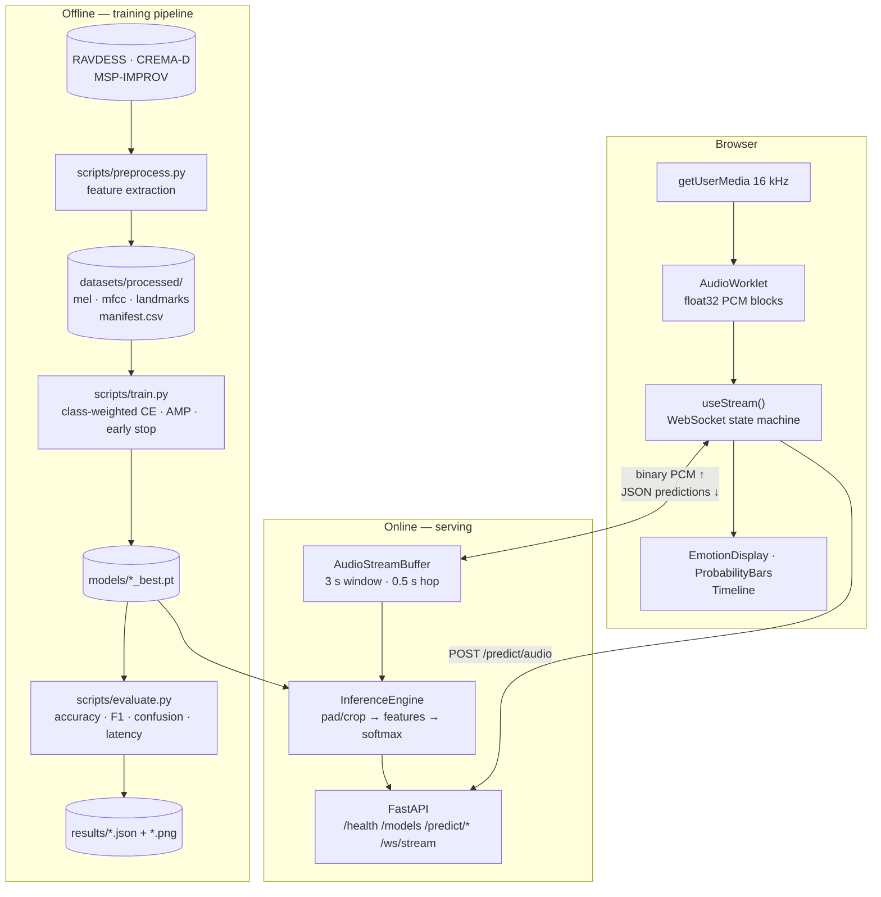

# SER System — Multimodal Speech Emotion Recognition for Healthcare Environments

A full-stack research system for recognising emotion from speech and facial expression, built to
investigate how well multimodal affect recognition transfers into **healthcare and caregiving
settings** — clinical wards, elder care, and patient-facing triage, where a patient's emotional
state carries diagnostic information that a spoken transcript alone loses.

The system spans the whole path from raw corpora to a live browser demo: dataset parsing, feature
extraction, six model architectures (three unimodal, three fusion strategies), a training and
evaluation harness, a FastAPI inference server with WebSocket streaming, and a React front end that
classifies emotion from a live microphone in near real time.

```
 corpora ──▶ preprocess ──▶ train ──▶ evaluate ──▶ serve ──▶ browser
 RAVDESS      log-mel        6 model    accuracy    FastAPI   React +
 CREMA-D      MFCC+Δ+ΔΔ      variants   macro-F1    WebSocket AudioWorklet
 MSP-IMPROV   landmarks      AMP/ES     latency     hot-swap  live timeline
```

---

## Table of contents

- [Research context](#research-context)
- [Current status](#current-status)
- [Key capabilities](#key-capabilities)
- [System architecture](#system-architecture)
- [Repository layout](#repository-layout)
- [Quick start](#quick-start)
- [End-to-end walkthrough](#end-to-end-walkthrough)
- [Emotion taxonomy](#emotion-taxonomy)
- [Datasets](#datasets)
- [Feature extraction](#feature-extraction)
- [Model zoo](#model-zoo)
- [Training](#training)
- [Evaluation](#evaluation)
- [Backend API](#backend-api)
- [Front end](#front-end)
- [Configuration](#configuration)
- [Testing](#testing)
- [Known issues and limitations](#known-issues-and-limitations)
- [Roadmap](#roadmap)
- [Documentation index](#documentation-index)
- [Design decisions and rationale](#design-decisions-and-rationale)
- [Contributing](#contributing)

---

## Research context

Speech emotion recognition (SER) benchmarks are dominated by acted, studio-recorded, largely
North-American English corpora. A model that reports 70%+ accuracy on RAVDESS is not thereby a model
that can tell a distressed patient from a calm one in a noisy ward, in a second language, on cheap
hardware. The gap between those two claims is the thing this project exists to measure.

Three concerns shape the design:

1. **Speaker independence is not optional.** SER results are routinely inflated by allowing the same
   speaker into both train and test splits — the model learns the voice, not the affect. Every split
   here is speaker-disjoint by construction ([`speaker_independent_split`](src/datasets.py#L124)),
   and the disjointness is asserted in the test suite.
2. **Multimodality is a hypothesis, not an assumption.** Adding a visual stream is widely assumed to
   help. Whether it helps *enough to justify a camera in a clinical room* — with the privacy,
   compute, and consent costs that implies — is an empirical question. So the repository ships three
   unimodal baselines and three distinct fusion strategies that can be trained and evaluated under
   identical conditions.
3. **Latency is a first-class metric.** A system that classifies emotion 4 seconds late is not
   usable at a bedside. [`scripts/evaluate.py`](scripts/evaluate.py) therefore reports mean/p50/p95/p99
   inference latency alongside accuracy and F1, and the serving path is built around a 3-second
   window with a 0.5-second hop so predictions refresh twice per second.

The unified six-class label set (see [Emotion taxonomy](#emotion-taxonomy)) is a deliberate
narrowing: it is the largest set of categories that all three source corpora agree on, which is what
makes cross-corpus training possible at all.

> **Note on scope.** The three corpora used here are acted, non-Nigerian, and recorded in studio
> conditions. They are a starting point for architecture and infrastructure work, not evidence about
> Nigerian clinical speech. Closing that gap requires in-domain data collection; see
> [Roadmap](#roadmap).

---

## Current status

Being explicit about this, because the repository contains a complete pipeline that has not yet been
run on real data:

| Component | Status | Notes |
|---|---|---|
| Feature extraction | ✅ Implemented, tested | Audio path verified; visual path unverified (see below) |
| Dataset parsers | ✅ Implemented, tested | RAVDESS, CREMA-D, MSP-IMPROV |
| Speaker-independent split | ✅ Implemented, tested | Disjointness + reproducibility asserted |
| 6 model architectures | ✅ Implemented, tested | Forward shape, gradient flow, determinism |
| Training harness | ✅ Implemented | Never executed on real data |
| Evaluation harness | ✅ Implemented | Never executed on real data |
| FastAPI backend | ✅ Implemented, tested | 20 tests, engine mocked |
| React front end | ✅ Implemented | Manual verification only, no JS test suite |
| **Trained checkpoints** | ❌ None | [`models/`](models/) is empty |
| **Downloaded corpora** | ❌ None | [`datasets/`](datasets/) is empty |
| **Reported results** | ❌ None | No accuracy/F1/latency numbers exist yet |

**Test suite: 87 tests, all passing** (`python3 -m pytest`, ~19 s on CPU).

Because no checkpoint exists, the backend starts in a degraded mode: `/health` reports
`model_loaded: false` and the prediction endpoints return **503**. This is intentional — the server
is designed to boot without a model rather than crash, so the front end can be developed against it.

---

## Key capabilities

**Machine learning**

- Log-mel spectrogram and MFCC (+ Δ + ΔΔ) audio front ends, configurable via YAML
- MediaPipe FaceMesh facial-landmark sequence extraction, translation- and scale-normalised per frame
- Cross-corpus training over three datasets mapped to one six-class taxonomy
- Speaker-disjoint train/val/test splitting with a fixed seed for reproducibility
- Six architectures: 2-D CNN, CNN+BiLSTM with attention pooling, landmark BiLSTM, and three fusion
  strategies (feature-level concatenation, learned decision-level weighting, cross-modal attention)
- Class-weighted cross-entropy to counter the label imbalance that cross-corpus merging introduces
- AdamW + cosine annealing, gradient clipping at 1.0, mixed precision, early stopping, TensorBoard

**Serving**

- FastAPI app with lifespan-managed model loading, so a missing checkpoint degrades instead of crashing
- File upload prediction for any format libsndfile can read
- WebSocket streaming with server-side sliding-window buffering (3 s window, 0.5 s hop)
- Runtime checkpoint hot-swap without a restart — useful for A/B-ing architectures in a demo
- Automatic resampling from the browser's 16 kHz capture rate to the model's 22.05 kHz

**Front end**

- AudioWorklet-based raw PCM capture with a ScriptProcessorNode fallback for older browsers
- Live emotion display, animated per-class probability bars, scrolling prediction timeline
- Drag-and-drop file analysis alongside live streaming
- Backend health polling with a traffic-light status indicator

---

## System architecture



Three boundaries matter:

- **Preprocessing is fully offline.** Training reads `.npy` arrays, never audio files. Feature
  extraction happens once; epochs are then I/O-cheap. The cost is that changing any audio config key
  invalidates the whole processed cache.
- **The inference engine is checkpoint-driven, not config-driven.** A checkpoint embeds the config it
  was trained with, and [`InferenceEngine`](backend/inference.py#L42) rebuilds the architecture from
  `ckpt["cfg"]` rather than from the config on disk. A checkpoint trained six months ago still loads
  correctly after the YAML has moved on.
- **Windowing lives on the server, not the client.** The browser sends whatever block size the audio
  graph produces; [`AudioStreamBuffer`](backend/stream.py#L19) accumulates, bounds memory to two
  windows, resamples, and decides when to fire. Client-side buffering logic stays trivial.

---

## Repository layout

```
SER-System/
├── README.md                   ← you are here
├── pytest.ini                  test discovery + warning filters
├── config/
│   └── settings.yaml           single source of truth for all hyperparameters
├── src/                        reusable library code
│   ├── features.py             audio + visual feature extraction
│   ├── datasets.py             corpus parsers, speaker split, torch Dataset
│   └── models/
│       ├── audio.py            AudioCNN, AudioCNNLSTM
│       ├── visual.py           VisualLSTM
│       ├── fusion.py           feature / decision / cross-modal-attention fusion
│       └── builder.py          name → nn.Module factory
├── scripts/                    CLI entry points
│   ├── preprocess.py           corpora → datasets/processed/*.npy + manifest.csv
│   ├── train.py                manifest → models/<name>_best.pt
│   └── evaluate.py             checkpoint → results/*.json + confusion matrix
├── backend/                    FastAPI inference service
│   ├── main.py                 app, routes, WebSocket handler, lifespan
│   ├── inference.py            InferenceEngine
│   ├── stream.py               AudioStreamBuffer
│   ├── schemas.py              Pydantic response models
│   └── requirements.txt        Python dependencies
├── frontend/                   React 18 + Vite client
│   ├── src/
│   │   ├── App.jsx             layout, health polling, file upload
│   │   ├── hooks/useStream.js  mic → WebSocket → prediction state machine
│   │   ├── components/         Header, AudioCapture, EmotionDisplay,
│   │   │                       ProbabilityBars, Timeline
│   │   ├── constants.js        emotion labels, colours, emoji
│   │   └── index.css           design tokens + all component styles
│   ├── public/worklets/
│   │   └── pcm-processor.js    AudioWorkletProcessor — raw PCM tap
│   └── vite.config.js          dev server on :3000, /api proxy to :8000
├── tests/                      87 pytest tests
│   ├── conftest.py             synthetic sine-wave fixtures
│   ├── test_features.py        16 tests
│   ├── test_datasets.py        22 tests
│   ├── test_model.py           29 tests
│   └── test_api.py             20 tests
├── docs/                       full documentation — see index below
│   ├── backend/
│   └── frontend/
├── datasets/                   corpora (gitignored, empty on clone)
├── models/                     checkpoints (gitignored, empty on clone)
└── notebooks/                  exploratory analysis
```

Directories that are empty on a fresh clone — `datasets/`, `models/`, `notebooks/`, `results/`,
`runs/` — are populated by the pipeline and excluded by [`.gitignore`](.gitignore). Model weights and
corpora are deliberately not version-controlled.

---

## Quick start

### Prerequisites

| Requirement | Version | Notes |
|---|---|---|
| Python | 3.10+ | `X \| None` union syntax is used in `backend/main.py` |
| Node.js | 18+ | Vite 4 requirement |
| ffmpeg | any | Optional — only for mp3 input |
| CUDA GPU | optional | Mixed precision activates automatically when available |

### 1. Backend

```bash
git clone <your-repo-url> SER-System
cd SER-System

python3 -m venv .venv
source .venv/bin/activate          # Windows: .venv\Scripts\activate
pip install -r backend/requirements.txt

python3 -m pytest                  # expect: 87 passed
uvicorn backend.main:app --reload --port 8000
```

The server logs `[SER] No checkpoint at 'models/audio_cnn_lstm_best.pt' — prediction endpoints will
return 503` on a fresh clone. That is expected; it will still serve `/health`, `/models`, and the
interactive docs at <http://localhost:8000/docs>.

### 2. Front end

```bash
cd frontend
npm install
npm run dev                        # http://localhost:3000
```

The header status dot shows amber while polling, green once `/health` reports a loaded model, red if
the backend is unreachable or has no model.

### 3. Verify the round trip

```bash
curl -s localhost:8000/health | python3 -m json.tool
```

```json
{
  "status": "ok",
  "model_loaded": false,
  "model_name": null,
  "device": "n/a",
  "sample_rate": 0
}
```

Live streaming and file prediction stay unavailable until a checkpoint exists — see the next section.

---

## End-to-end walkthrough

### Step 1 — Obtain corpora

Download at least one dataset and place it where [`config/settings.yaml`](config/settings.yaml)
expects it. Every parser is independently optional: `load_datasets` skips any missing directory with
a log line and only raises if *all* three are absent.

```
datasets/
├── RAVDESS/          Actor_01/03-01-05-01-02-01-12.wav (+ optional .mp4)
├── CREMA-D/
│   ├── AudioWAV/     1001_DFA_ANG_XX.wav
│   └── VideoFlash/   1001_DFA_ANG_XX.flv
└── MSP-IMPROV/
    ├── Audio/        MSP-IMPROV-S01A-M01-P-FM01.wav
    └── Evalution.txt (semicolon-delimited; original typo preserved)
```

See [docs/datasets.md](docs/datasets.md) for filename grammars, label maps, and acquisition links.

### Step 2 — Extract features

```bash
python3 scripts/preprocess.py
```

Writes, for every parsed sample:

| Output | Shape (default config) | Contents |
|---|---|---|
| `datasets/processed/mel/<stem>.npy` | `(128, 130)` | Normalised log-mel spectrogram |
| `datasets/processed/mfcc/<stem>.npy` | `(120, 130)` | 40 MFCC + Δ + ΔΔ, per-coefficient normalised |
| `datasets/processed/landmarks/<stem>.npy` | `(75, 1404)` | Flattened FaceMesh landmark sequence |
| `datasets/processed/manifest.csv` | — | `audio_path, video_path, label, speaker, dataset` |

The step is **idempotent** — existing `.npy` files are skipped, so an interrupted run resumes.
Per-file failures are collected rather than fatal and written to `errors_audio.txt` /
`errors_visual.txt`.

### Step 3 — Train

```bash
python3 scripts/train.py --model audio_cnn_lstm --feature mel
```

Prints the speaker-disjoint split sizes and parameter count, then trains with class-weighted
cross-entropy, cosine LR annealing, gradient clipping, and early stopping (patience 15 on validation
loss). Best-by-validation-loss weights go to `models/audio_cnn_lstm_best.pt`; TensorBoard scalars to
`runs/audio_cnn_lstm/`. The held-out test split is written to `datasets/processed/test_split.csv` so
evaluation uses exactly the same speakers.

```bash
tensorboard --logdir runs/
```

### Step 4 — Evaluate

```bash
python3 scripts/evaluate.py --checkpoint models/audio_cnn_lstm_best.pt --latency_runs 200
```

Produces accuracy, weighted and macro F1, a per-class classification report, a confusion-matrix PNG
in `results/`, and a latency distribution (mean, p50, p95, p99) benchmarked with 10 warm-up
iterations and CUDA synchronisation where applicable.

### Step 5 — Serve

```bash
MODEL_CHECKPOINT=models/audio_cnn_lstm_best.pt uvicorn backend.main:app --port 8000
```

Reload the front end; the status dot turns green and the microphone button becomes live.

---

## Emotion taxonomy

Six classes, fixed in [`src/datasets.py`](src/datasets.py#L9) and mirrored in
[`frontend/src/constants.js`](frontend/src/constants.js):

| Index | Label | UI colour | Emoji |
|---|---|---|---|
| 0 | `neutral` | `#94a3b8` slate | 😐 |
| 1 | `happy` | `#fbbf24` amber | 😊 |
| 2 | `sad` | `#60a5fa` blue | 😢 |
| 3 | `angry` | `#f87171` red | 😠 |
| 4 | `fearful` | `#a78bfa` violet | 😨 |
| 5 | `disgust` | `#34d399` green | 🤢 |

Two mapping decisions are worth stating outright, since they affect every number the system will
ever report:

- **RAVDESS `calm` → `neutral`.** Calm and neutral are acoustically close and no other corpus
  distinguishes them. Merging keeps the taxonomy shared; it also means `neutral` is over-represented
  and slightly heterogeneous.
- **RAVDESS `surprised` → dropped.** Neither CREMA-D nor MSP-IMPROV has a surprise category, and a
  class present in only one corpus would be learnable purely from corpus-specific artefacts. Those
  samples are discarded, not relabelled.

MSP-IMPROV contributes only four of the six classes (`angry`, `happy`, `sad`, `neutral`), so merging
it in shifts the class balance. This is exactly what the class-weighted loss compensates for.

---

## Datasets

| Corpus | Modality | Speakers | Emotion code | Parser |
|---|---|---|---|---|
| **RAVDESS** | audio + video | 24 actors | 3rd `-` field (`01`–`08`) | [`parse_ravdess`](src/datasets.py#L18) |
| **CREMA-D** | audio + video | 91 actors | 3rd `_` field (`ANG`…`SAD`) | [`parse_cremad`](src/datasets.py#L38) |
| **MSP-IMPROV** | audio | 12 actors | `Evalution.txt` field 2 | [`parse_msp_improv`](src/datasets.py#L60) |

Every parser emits the same five-column schema, which is what makes the corpora concatenable:

```python
{"audio_path": str, "video_path": str | None, "label": str, "speaker": str, "dataset": str}
```

`speaker` is namespaced per corpus (`ravdess_12`, `cremad_1001`, `msp_…`) so that identifier
collisions across datasets cannot silently merge two different people into one split unit.
`video_path` is `None` whenever the companion video is absent, and the Dataset zero-fills the visual
tensor in that case — which is how audio-only corpora participate in multimodal training at all.

Full detail: [docs/datasets.md](docs/datasets.md).

---

## Feature extraction

All three feature types are derived from a fixed 3-second window. Clips longer than 3 s are
**centre-cropped**; shorter clips are **symmetrically zero-padded**. Centre-cropping is the right
default for acted corpora, where the emotional peak sits mid-utterance and the edges are silence.

**Audio — log-mel spectrogram** → `(128, 130)`

`melspectrogram` → `power_to_db(ref=max)` → global mean/std normalisation. With
`sr=22050, duration=3.0, n_fft=2048, hop_length=512`:
`floor(22050 × 3 / 512) + 1 = 130` frames, `n_mels=128` bands. The `f_min=20 / f_max=8000` band
limits discard inaudible rumble and the sparse top octave.

**Audio — MFCC + Δ + ΔΔ** → `(120, 130)`

40 cepstral coefficients stacked with first and second temporal derivatives (`40 × 3 = 120`),
normalised **per coefficient** rather than globally, because MFCC dimensions differ in scale by
orders of magnitude.

**Visual — FaceMesh landmark sequence** → `(75, 1404)`

Per frame: MediaPipe FaceMesh → landmark `(x, y, z)` array → subtract centroid → divide by max radius
→ flatten. Centroid subtraction removes head translation and radius division removes apparent-size
variation, so the network sees expression geometry rather than where the head happened to be.
Sequences shorter than 75 frames are zero-padded at the end.

Full detail, including the exact normalisation formulas: [docs/features.md](docs/features.md).

---

## Model zoo

Parameter counts below are measured from the default [`config/settings.yaml`](config/settings.yaml)
with `num_classes=6`:

| `--model` | Architecture | Params | Input(s) | Embed dim |
|---|---|---:|---|---|
| `audio_cnn` | 4-block 2-D CNN + adaptive avg-pool + MLP | 1,438,694 | `(B,1,128,130)` | 4096 |
| `audio_cnn_lstm` | 3-block CNN → 2-layer BiLSTM(256) + attention pooling | 6,458,982 | `(B,1,128,130)` | 512 |
| `visual_lstm` | Linear(1404→256) → 2-layer BiLSTM(256) + attention pooling | 3,055,750 | `(B,75,1404)` | 512 |
| `feature_level` | Concatenate audio ⊕ visual embeddings → MLP(512) | 10,042,610 | both | — |
| `decision_level` | Softmax-weighted sum of unimodal logits | 9,514,734 | both | — |
| `attention` | Bidirectional cross-modal MultiheadAttention (8 heads) | 11,881,970 | both | — |

**Attention pooling** is shared by both recurrent models: rather than taking the final hidden state,
the BiLSTM output is weighted by `softmax(mean(out, dim=-1))` over time and summed. Cheap — no extra
parameters — and it lets the model concentrate on the emotionally salient part of the window instead
of whatever happened at the end of it.

**The three fusion strategies form a deliberate ladder** of increasing coupling, so the experiment can
distinguish *how much* cross-modal interaction is actually needed:

- `feature_level` — earliest interaction. Concatenated embeddings, joint MLP. Most expressive, most
  prone to letting the stronger modality dominate.
- `decision_level` — latest interaction. Each modality classifies independently; two learned scalars
  (softmax-normalised, so they sum to 1) mix the logits. Highly interpretable — the learned weights
  *are* the answer to "which modality mattered?" — and robust when one stream is unreliable.
- `attention` — audio attends to visual and visual attends to audio via two `MultiheadAttention`
  blocks with residual connections and LayerNorm. Most parameters, most capacity to model
  interaction, most data-hungry.

Both `audio_cnn_lstm` and `visual_lstm` expose a 512-dim embedding, which is what lets the
cross-attention fusion skip a projection on the audio side. `CrossModalAttentionFusion` still guards
against mismatch with a conditional `nn.Linear` (`nn.Identity` when the dims already agree), so
changing `lstm_hidden` in the config will not break it.

Every architecture is reachable by name through [`build_model`](src/models/builder.py#L36); nothing
in the training, evaluation, or serving code needs to know which one it holds. See
[docs/models.md](docs/models.md) for layer-by-layer tensor traces.

---

## Training

```bash
python3 scripts/train.py --model {audio_cnn|audio_cnn_lstm|visual_lstm|feature_level|decision_level|attention} \
                         --feature {mel|mfcc} \
                         --config config/settings.yaml
```

Defaults from [`config/settings.yaml`](config/settings.yaml):

| Setting | Value | Why |
|---|---|---|
| Optimiser | AdamW, lr 1e-4, wd 1e-4 | Decoupled weight decay; 1e-4 is conservative for small corpora |
| Scheduler | `CosineAnnealingLR(T_max=epochs)` | Smooth decay, no step-size tuning |
| Batch size | 32 | Fits an 8 GB GPU for the fusion models |
| Epochs | 100 (early stop patience 15) | Early stopping is the real terminator |
| Loss | Cross-entropy, `class_weight="balanced"` | Cross-corpus merging skews class counts badly |
| Gradient clipping | max-norm 1.0 | LSTM stability |
| Mixed precision | on when CUDA present | ~2× throughput; `unscale_` before clipping so the clip sees true gradients |
| Seed | 42 (`torch` + `numpy`) | With the fixed split seed, runs are reproducible |
| Split | 70 / 15 / 15 speaker-disjoint | — |

Model selection is on **validation loss**, not validation accuracy — loss is the smoother signal on
small validation sets, where accuracy moves in visible discrete jumps.

Checkpoints are self-describing, which is what makes the serving layer version-tolerant:

```python
{"epoch": int, "model": state_dict, "val_loss": float, "val_acc": float,
 "model_name": str, "feature": str, "cfg": dict}   # cfg = the FULL settings.yaml
```

Full walkthrough: [docs/training.md](docs/training.md).

---

## Evaluation

```bash
python3 scripts/evaluate.py --checkpoint models/<name>_best.pt --latency_runs 100
```

Reports overall accuracy, weighted F1, macro F1, a per-class precision/recall/F1 table, a
confusion-matrix heatmap, and a latency distribution. Results are written to
`results/<model>_results.json` for cross-architecture comparison.

**Read macro F1, not accuracy.** With an imbalanced six-class problem, accuracy rewards a model for
being right about the majority class. Macro F1 weights all six equally, which is what a clinical
screening use case actually cares about — missing `fearful` is not made acceptable by nailing
`neutral`.

The latency benchmark uses synthetic tensors, not the test set, so it measures **model forward pass
only** — not feature extraction, not I/O. Wall-clock latency observed at the API is meaningfully
higher; the `latency_ms` field in a prediction response covers pad/crop + feature extraction +
forward + softmax, which is the number that matters for the live demo.

Full detail: [docs/evaluation.md](docs/evaluation.md).

---

## Backend API

FastAPI, served with uvicorn. Interactive OpenAPI docs at `/docs` when running.

| Method | Path | Purpose |
|---|---|---|
| `GET` | `/health` | Liveness, model-loaded flag, active model name, device, sample rate |
| `GET` | `/models` | List `.pt` checkpoints under `models/` and the active one |
| `POST` | `/predict/audio` | Multipart file upload → prediction |
| `POST` | `/predict/switch` | Hot-swap the active checkpoint (`?checkpoint=path`) |
| `WS` | `/ws/stream` | Real-time PCM streaming → continuous predictions |

Environment variables:

| Variable | Default | Purpose |
|---|---|---|
| `MODEL_CHECKPOINT` | `models/audio_cnn_lstm_best.pt` | Checkpoint loaded at startup |
| `CONFIG_PATH` | `config/settings.yaml` | Config for the inference engine |
| `CORS_ORIGINS` | `*` | Comma-separated allowed origins |

A prediction response:

```json
{
  "emotion": "happy",
  "confidence": 0.8734,
  "probabilities": {"neutral": 0.0412, "happy": 0.8734, "sad": 0.0201,
                    "angry": 0.0310, "fearful": 0.0221, "disgust": 0.0122},
  "latency_ms": 12.47,
  "model_name": "audio_cnn_lstm"
}
```

The WebSocket protocol is a JSON handshake followed by binary float32 PCM frames, with tagged JSON
messages (`ready` / `prediction` / `info` / `error`) coming back. Full message-by-message
specification: [docs/backend/websocket-protocol.md](docs/backend/websocket-protocol.md). Endpoint
reference with status codes and failure modes:
[docs/backend/api-reference.md](docs/backend/api-reference.md).

---

## Front end

React 18 + Vite, no UI framework, no state library — 11 source files, ~800 lines including CSS.

| File | Responsibility |
|---|---|
| [`App.jsx`](frontend/src/App.jsx) | Layout, 10-second `/health` polling, file-upload handler, live-over-file prediction precedence |
| [`hooks/useStream.js`](frontend/src/hooks/useStream.js) | The whole streaming state machine: mic → AudioContext → WebSocket → prediction state, plus teardown |
| [`components/AudioCapture.jsx`](frontend/src/components/AudioCapture.jsx) | Mic button and drag-and-drop upload zone |
| [`components/EmotionDisplay.jsx`](frontend/src/components/EmotionDisplay.jsx) | Dominant emotion, confidence and latency chips, re-triggered CSS animation on change |
| [`components/ProbabilityBars.jsx`](frontend/src/components/ProbabilityBars.jsx) | All six classes as colour-coded bars, always all six so the layout never reflows |
| [`components/Timeline.jsx`](frontend/src/components/Timeline.jsx) | Horizontally scrolling emoji history, auto-scrolled to newest, capped at 60 entries |
| [`components/Header.jsx`](frontend/src/components/Header.jsx) | Status dot + label derived from stream status and backend health |
| [`public/worklets/pcm-processor.js`](frontend/public/worklets/pcm-processor.js) | `AudioWorkletProcessor` that copies each float32 block and transfers the buffer to the main thread |

The capture chain is the interesting part: `getUserMedia({sampleRate: 16000})` → `AudioContext` →
`AudioWorkletNode` → `postMessage` with an ownership **transfer** (zero-copy) → `ws.send(ArrayBuffer)`.
If `audioWorklet.addModule` throws — older Safari, insecure context — the hook silently falls back to
a deprecated `ScriptProcessorNode`, so the demo degrades rather than dies.

Note that the front end never buffers or windows audio; it forwards blocks as they arrive and lets
the server decide when a window is complete. See
[docs/frontend/audio-pipeline.md](docs/frontend/audio-pipeline.md).

---

## Configuration

[`config/settings.yaml`](config/settings.yaml) is the single source of truth for data paths, feature
parameters, the emotion maps, per-architecture hyperparameters, training settings, and output
directories. Scripts take `--config` so alternative configs can be swapped in for experiments.

Two cautions:

1. **Changing anything under `audio:` or `visual:` invalidates `datasets/processed/`.** Preprocessing
   skips files that already exist and does not track which config produced them. Delete the
   processed directory after changing feature parameters, or you will silently train on a mix.
2. **`emotions.unified` order defines the class indices.** Reordering it changes the meaning of every
   existing checkpoint's output layer. The front end's `EMOTIONS` array must be kept in the same
   order.

Key-by-key reference: [docs/configuration.md](docs/configuration.md).

---

## Testing

```bash
python3 -m pytest                      # all 87
python3 -m pytest tests/test_model.py  # one module
python3 -m pytest -k websocket         # by name
```

| Module | Tests | What it pins down |
|---|---|---|
| [`test_features.py`](tests/test_features.py) | 16 | Pad/crop symmetry, centre-crop position, resampling, exact feature shapes, normalisation statistics, **no NaNs on pure silence** |
| [`test_datasets.py`](tests/test_datasets.py) | 22 | Filename grammars per corpus, dropped/`None` labels, speaker prefixes, **split disjointness**, split reproducibility, fraction bounds, zero-fill on missing video |
| [`test_model.py`](tests/test_model.py) | 29 | Forward shapes for all six models, embedding dims, audio/visual dim agreement, **gradient reaches every parameter**, eval-mode determinism, no NaN outputs, factory correctness, decision weights sum to 1 |
| [`test_api.py`](tests/test_api.py) | 20 | Every endpoint's success and failure paths, 503 with no model, 422 on empty upload, probabilities sum to 1, checkpoint switching, WebSocket handshake, streaming until a window fills, `reset`, `ping`/`pong` |

Two properties are worth calling out because they encode the project's core correctness claims:

- **Silence must not produce NaNs.** `power_to_db` on an all-zero signal is a classic source of
  `-inf` → NaN propagation, and a live microphone stream *will* contain silent windows. Tested
  directly.
- **Speaker splits must be disjoint.** The claim that the reported numbers are speaker-independent
  is only as good as this assertion, so it is asserted rather than assumed.

Tests use synthetic sine-wave fixtures ([`conftest.py`](tests/conftest.py)) and a mocked inference
engine, so the suite runs in ~19 s on CPU with no corpora and no checkpoints present. That is
deliberate — CI must not depend on licensed data.

Full breakdown: [docs/testing.md](docs/testing.md).

---

## Known issues and limitations

Found while documenting the codebase and verified by direct execution. None are blocking on the
audio-only path, which is the one that has been exercised; all three sit on paths that no real data
has ever traversed.

### 1. `--feature mfcc` crashes the CNN models — **confirmed**

[`EmotionDataset._load_audio`](src/datasets.py#L166) only adds a channel dimension when
`feature == "mel"`. MFCC tensors therefore reach the model as `(B, 120, 130)`, and `Conv2d` reads the
batch dimension as channels:

```
RuntimeError: Given groups=1, weight of size [32, 1, 3, 3],
expected input[1, 4, 120, 130] to have 1 channels, but got 4 channels instead
```

The MFCC extraction itself is correct and tested; only the CNN feeding path is wrong. The `mfcc`
branch of [`InferenceEngine._to_tensor`](backend/inference.py#L73) has the same shape bug. **Fix:**
`unsqueeze(0)` unconditionally in `_load_audio`, and use `.unsqueeze(0).unsqueeze(0)` on the
inference side. Until then, use `--feature mel`.

### 2. Landmark dimensionality is probably 1434, not 1404 — **needs verification with mediapipe installed**

[`extract_visual_features`](src/features.py#L97) constructs FaceMesh with `refine_landmarks=True`,
which adds 10 iris landmarks to the base 468 → **478 landmarks → 1434 values**. But
`VisualLSTM.input_dim`, the zero-fill in `_load_visual`, and `InferenceEngine._zero_visual` all
assume 1404. If MediaPipe behaves as documented, real landmark files will not load into the visual
model at all. The test suite does not catch this because it feeds synthetic `zeros(75, 1404)`.

`mediapipe` is not installed in the current environment, so this is reasoned from the library's
documented behaviour rather than observed. **Fix:** either set `refine_landmarks=False` (keeps 1404)
or set `input_dim=1434` everywhere — and derive the constant in one place rather than hard-coding it
in three.

### 3. MSP-IMPROV speaker IDs collapse to a single speaker — **confirmed by inspection**

[`parse_msp_improv`](src/datasets.py#L90) derives the speaker as `f"msp_{fname[:6]}"`. Real
MSP-IMPROV filenames all begin `MSP-IMPROV-…`, so `fname[:6]` is `"MSP-IM"` for every file in the
corpus. All MSP-IMPROV samples land in one split unit, which means they all go to train, or all to
val, or all to test. The speaker-independence guarantee holds trivially but the split is badly
unbalanced, and MSP-IMPROV may vanish from training entirely depending on the seed. **Fix:** parse
the actual speaker field (e.g. the `M01`/`F02` segment) instead of a fixed character slice.

### Other constraints

- **Multimodal checkpoints served over the API run effectively audio-only.** There is no video
  ingestion path in the backend, so [`_zero_visual`](backend/inference.py#L79) feeds a zero tensor to
  the visual branch. Fusion models will load and predict, but their visual half contributes nothing
  at inference time. A fusion model's *reported* accuracy therefore does not describe its *served*
  accuracy.
- **`_load_visual` hard-codes `zeros(75, 1404)`** rather than reading `visual.max_frames` from the
  config, so changing `max_frames` breaks batch collation for samples without video.
- **Three-second fixed window.** Emotional cues spanning longer turns are outside the model's view.
- **No voice-activity detection.** Silent or non-speech windows are classified anyway, usually as
  whatever class the model treats as its null hypothesis.
- **`torch.cuda.amp.GradScaler()`** is the deprecated spelling; it works but emits a warning on
  recent PyTorch. The modern form is `torch.amp.GradScaler("cuda")`.
- **No JS test suite.** The front end has been verified only by hand.
- **Acted, non-clinical, non-Nigerian corpora.** The central external-validity limitation, and the
  reason the roadmap starts where it does.

---

## Roadmap

**Immediate — unblock the pipeline**

- [ ] Fix the three issues above (MFCC channel dim, landmark dimensionality, MSP speaker parsing)
- [ ] Download corpora and run `preprocess.py` end to end; record the sample counts per class
- [ ] Train all six architectures under identical conditions and publish the comparison table
- [ ] Fill in the empty `results/` numbers this README currently cannot report

**Near term — make the comparison meaningful**

- [ ] Voice-activity detection ahead of the inference window, so silence is not classified
- [ ] Temporal smoothing over consecutive stream predictions to stop single-window flicker
- [ ] Confusion analysis per corpus — does cross-corpus training help or just average away?
- [ ] Ablate the visual stream properly: is `decision_level`'s learned weight actually non-trivial?
- [ ] Notebooks in `notebooks/` for class balance, feature distributions, and error analysis

**Longer term — the actual research question**

- [ ] Video ingestion in the streaming path, so fusion models are served as trained
- [ ] Noise and reverberation augmentation matched to ward acoustics
- [ ] In-domain Nigerian healthcare speech collection, with ethics review and informed consent
- [ ] Cross-corpus and cross-lingual transfer evaluation against that in-domain set
- [ ] Quantisation and ONNX export for deployment on the hardware clinics actually have
- [ ] Calibration analysis — a confidence score that clinicians can act on must mean something

---

## Documentation index

### Core

| Document | Contents |
|---|---|
| [docs/README.md](docs/README.md) | Documentation map and suggested reading order |
| [docs/architecture.md](docs/architecture.md) | Layer boundaries, data flow, tensor shapes end to end, design rationale |
| [docs/setup.md](docs/setup.md) | Installation, virtual environments, GPU setup, troubleshooting |
| [docs/configuration.md](docs/configuration.md) | Every `settings.yaml` key, valid ranges, invalidation rules |
| [docs/datasets.md](docs/datasets.md) | Corpus acquisition, filename grammars, label maps, split algorithm |
| [docs/features.md](docs/features.md) | Mel, MFCC, and landmark extraction with formulas and shapes |
| [docs/models.md](docs/models.md) | All six architectures, layer-by-layer traces, parameter counts |
| [docs/training.md](docs/training.md) | Training loop, hyperparameters, checkpoints, TensorBoard |
| [docs/evaluation.md](docs/evaluation.md) | Metrics, confusion matrices, latency methodology |
| [docs/testing.md](docs/testing.md) | Test-by-test breakdown, fixtures, adding tests |

### Backend

| Document | Contents |
|---|---|
| [docs/backend/README.md](docs/backend/README.md) | Service overview, module responsibilities, request lifecycle |
| [docs/backend/api-reference.md](docs/backend/api-reference.md) | Every endpoint: request, response, status codes, failure modes |
| [docs/backend/websocket-protocol.md](docs/backend/websocket-protocol.md) | Handshake, frame types, timing, client implementation notes |
| [docs/backend/inference-engine.md](docs/backend/inference-engine.md) | `InferenceEngine` internals, checkpoint loading, buffering |
| [docs/backend/deployment.md](docs/backend/deployment.md) | uvicorn, environment, CORS, reverse proxy, containers |

### Front end

| Document | Contents |
|---|---|
| [docs/frontend/README.md](docs/frontend/README.md) | Stack, file map, dev workflow, build |
| [docs/frontend/components.md](docs/frontend/components.md) | Every component's props, state, and rendering logic |
| [docs/frontend/audio-pipeline.md](docs/frontend/audio-pipeline.md) | getUserMedia → AudioWorklet → WebSocket, with the fallback path |
| [docs/frontend/state-management.md](docs/frontend/state-management.md) | `useStream` state machine, refs, cleanup, known caveats |
| [docs/frontend/styling.md](docs/frontend/styling.md) | Design tokens, layout system, animations, theming |

---

## Design decisions and rationale

Recorded because the reasoning is not recoverable from the code, and future-you will want it.

**Why offline preprocessing to `.npy` instead of on-the-fly extraction?** Librosa feature extraction
is CPU-bound and would dominate epoch time; a 100-epoch run would repeat identical work 100 times.
The cost is a stale-cache hazard, mitigated only by documentation — an accepted trade.

**Why store the full config inside every checkpoint?** So `InferenceEngine` can rebuild the exact
architecture that produced the weights, regardless of how `settings.yaml` has since changed. Without
it, editing a hyperparameter silently breaks every older checkpoint with a shape-mismatch error.

**Why does the server boot without a model?** A crash-on-missing-checkpoint server cannot be
developed against before the first model exists. Returning 503 from prediction endpoints while
`/health` and `/models` stay live means front-end work proceeds in parallel with training.

**Why server-side windowing?** The browser's block size is dictated by the audio graph (typically 128
frames per render quantum). Putting the window/hop logic on the server keeps the client trivial,
makes the window size a server-side concern that can match the model's training duration, and means a
second client implementation only has to send bytes.

**Why weighted cross-entropy rather than resampling?** Merging three corpora with different class
inventories produces significant imbalance. Weighting uses every sample once per epoch;
over-sampling would repeat minority samples and invite memorisation on corpora this small.

**Why validation *loss* for model selection?** On a validation set of a few hundred speaker-disjoint
samples, accuracy is a step function and its argmax is noise. Loss is continuous and discriminates
between two models that happen to score the same accuracy.

**Why keep three fusion strategies rather than picking the best one?** Because which one wins *is* a
finding. Decision-level fusion's learned weights are directly interpretable evidence about modality
contribution — a result cross-attention cannot give you, however well it scores.

---

## Contributing

The repository is a research codebase; the conventions are light but worth keeping:

1. `python3 -m pytest` must stay green before any commit.
2. New behaviour comes with tests. The suite runs without corpora or checkpoints — keep it that way,
   so it stays runnable in CI.
3. Hyperparameters belong in [`config/settings.yaml`](config/settings.yaml), not in argument
   defaults, and not inline.
4. New architectures register in [`src/models/builder.py`](src/models/builder.py) and expose
   `embed(x)` plus `_embed_dim` if they are to be usable as a fusion backbone.
5. `datasets/`, `models/`, `runs/`, and `results/` are gitignored. Do not commit weights or corpora.
6. When a documented behaviour changes, update the corresponding page in `docs/`.

---

## Licensing and data use

No licence has been chosen for this repository yet — pick one before any public release.

The three corpora carry their own terms and are **not** redistributed here. RAVDESS is CC BY-NC-SA
4.0. CREMA-D and MSP-IMPROV require agreement to their respective academic-use licences. Obtain each
dataset from its original source and comply with its terms; if this work is published, cite the
corpora as their authors specify.

Any collection of clinical or patient speech is human-subjects research: ethics approval and
documented informed consent come before recording, not after.
