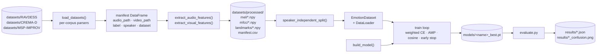
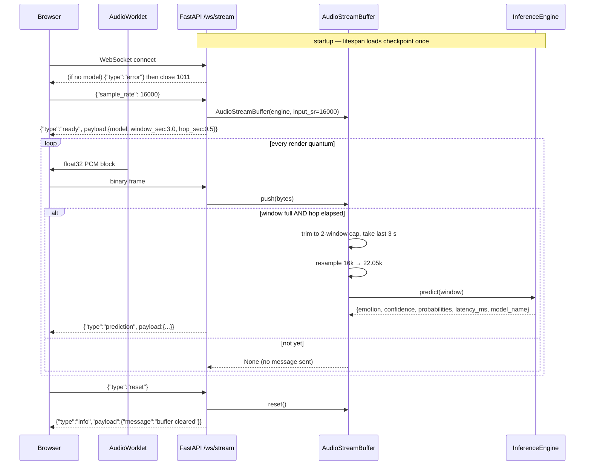

# Architecture

How the system is put together, where the boundaries are, and why they sit where they do.

- [Layer overview](#layer-overview)
- [The offline pipeline](#the-offline-pipeline)
- [The serving path](#the-serving-path)
- [Tensor shapes end to end](#tensor-shapes-end-to-end)
- [Key abstractions](#key-abstractions)
- [Design decisions](#design-decisions)
- [Extension points](#extension-points)

---

## Layer overview

Four layers, each depending only on the one below it:

```
┌──────────────────────────────────────────────────────────────┐
│  Presentation      frontend/                                  │
│  React 18 · Vite · AudioWorklet · WebSocket client            │
├──────────────────────────────────────────────────────────────┤
│  Service           backend/                                   │
│  FastAPI · InferenceEngine · AudioStreamBuffer · Pydantic     │
├──────────────────────────────────────────────────────────────┤
│  Library           src/                                       │
│  features · datasets · models (audio/visual/fusion/builder)   │
├──────────────────────────────────────────────────────────────┤
│  Configuration     config/settings.yaml                       │
└──────────────────────────────────────────────────────────────┘
                            ▲
                            │ CLI entry points
                     scripts/ (preprocess · train · evaluate)
```

The dependency direction is strict and worth preserving:

- `src/` imports nothing from `backend/` or `scripts/`. It is a plain library, importable from a
  notebook or a different serving stack.
- `backend/` imports from `src/` — [`inference.py`](../backend/inference.py#L21) pulls `UNIFIED`,
  `IDX2LABEL`, the feature functions, and `build_model`. There is exactly one feature-extraction
  implementation, shared between training and serving, which is what prevents train/serve skew.
- `scripts/` imports from `src/` and owns all CLI argument parsing. No library module parses arguments.
- Nothing imports from `frontend/`. The contract between the layers is HTTP and WebSocket only.

Both `backend/` and `scripts/` prepend the repository root to `sys.path` so that `src.` imports
resolve when run from the project directory without an installed package. It is a pragmatic choice
for a research repo; packaging with `pyproject.toml` would be the cleaner long-term answer.

---

## The offline pipeline



### Stage 1 — parsing

Each corpus has its own filename or label-file grammar, handled by
[`parse_ravdess`](../src/datasets.py#L18), [`parse_cremad`](../src/datasets.py#L38), and
[`parse_msp_improv`](../src/datasets.py#L60). All three emit the same five-column schema, which is the
only reason three structurally unrelated datasets can be concatenated:

```python
{"audio_path": str, "video_path": str | None,
 "label": str, "speaker": str, "dataset": str}
```

[`load_datasets`](../src/datasets.py#L96) calls each parser only if its directory exists, logs what it
found or skipped, and raises only when *all three* are missing. Partial installations are a supported
first-class case — you can start work with RAVDESS alone.

### Stage 2 — feature extraction

[`scripts/preprocess.py`](../scripts/preprocess.py) walks the manifest and writes one `.npy` per
sample per feature type. Three properties matter:

- **Idempotent.** Existing outputs are skipped, so an interrupted run resumes where it stopped.
- **Fault-tolerant.** A per-file exception is collected, not raised — corrupt files are logged to
  `errors_audio.txt` / `errors_visual.txt` and the run continues. On corpora of thousands of files,
  one bad header should not cost you the whole job.
- **Keyed by filename stem, not full path.** `Path(audio_path).stem` is the cache key. Two files with
  the same stem in different directories would collide; none of the three supported corpora have that
  problem, but a fourth might.

Visual extraction runs only for manifest rows with a non-null `video_path`, so audio-only corpora
cost nothing here.

### Stage 3 — splitting

[`speaker_independent_split`](../src/datasets.py#L124) shuffles the *unique speaker list* with a
seeded RNG and partitions speakers — not samples — into test, validation, and train. Two consequences:

- No speaker appears in more than one split. This is the property that makes reported accuracy a claim
  about generalisation to new people rather than to new recordings of known people.
- Split sizes are only approximately the requested fractions, because speakers contribute unequal
  sample counts. `test_split_respects_fractions` asserts loose bounds rather than exact sizes.

The same `seed` produces the same split, so `train.py` and `evaluate.py` agree on the test set without
having to communicate. `train.py` additionally writes `test_split.csv` so evaluation cannot drift even
if the seed or fractions change later.

### Stage 4 — training and evaluation

[`train.py`](../scripts/train.py) constructs the model from a name, wraps the split DataFrames in
[`EmotionDataset`](../src/datasets.py#L150), and runs the loop. See [training.md](training.md).
[`evaluate.py`](../scripts/evaluate.py) reloads a checkpoint, rebuilds the architecture from the
config embedded in it, and reports metrics plus latency. See [evaluation.md](evaluation.md).

---

## The serving path



### Startup

An `asynccontextmanager` lifespan handler ([`main.py`](../backend/main.py#L57)) loads the checkpoint
once into a module-level `engine`. If the file is missing or fails to load, `engine` stays `None` and
the server still starts. `_engine()` then raises 503 for prediction endpoints while `/health` and
`/models` continue to work.

This matters more than it looks: it is what allows front-end development to proceed before the first
model exists, and it turns "no model yet" into an ordinary, testable state rather than a boot failure.

### Windowing

[`AudioStreamBuffer`](../backend/stream.py#L19) owns all the timing logic:

| Parameter | Default | Role |
|---|---|---|
| `window_sec` | 3.0 | Must match the model's training duration |
| `hop_sec` | 0.5 | Minimum spacing between inferences → up to 2 predictions/second |
| buffer cap | `2 × window` | Bounds memory on a long-lived connection |

`push()` returns `None` until the buffer holds a full window *and* at least a hop's worth of new audio
has arrived since the last inference. The hop gate is what stops a client that sends 128-sample blocks
from triggering inference hundreds of times per second.

Errors inside `engine.predict` are caught and returned as `{"_error": msg}`, which the WebSocket
handler translates into an `error` frame. A single bad window does not tear down the connection.

### Resampling

The browser captures at 16 kHz (a `getUserMedia` constraint, and a common hardware-native rate); the
model expects 22.05 kHz. `AudioStreamBuffer` resamples each window with `librosa.resample` — after
windowing, not before, so exactly one resample happens per inference rather than one per block.

`librosa` is imported lazily inside the resample branch. When client and model rates already agree,
the import never happens.

---

## Tensor shapes end to end

Measured with the default config (`sr=22050, duration=3.0, n_fft=2048, hop_length=512, n_mels=128,
n_mfcc=40`):

### Audio, mel path

| Stage | Shape | Where |
|---|---|---|
| Raw waveform (3 s @ 22.05 kHz) | `(66150,)` | [`load_audio`](../src/features.py#L17) |
| Log-mel spectrogram | `(128, 130)` | [`mel_spectrogram`](../src/features.py#L29) |
| Stored `.npy` | `(128, 130)` | `preprocess.py` |
| Dataset item (channel added) | `(1, 128, 130)` | [`_load_audio`](../src/datasets.py#L166) |
| Batched | `(32, 1, 128, 130)` | DataLoader |
| After `AudioCNNLSTM.cnn` | `(32, 128, 16, 16)` | 3 × MaxPool2d(2) |
| Reshaped for LSTM | `(32, 16, 2048)` | `permute(0,3,1,2).reshape` |
| BiLSTM output | `(32, 16, 512)` | `hidden=256`, bidirectional |
| After attention pooling | `(32, 512)` | `(out * softmax(mean(out))).sum(1)` |
| Logits | `(32, 6)` | classification head |

Frame count: `floor(22050 × 3.0 / 512) + 1 = 130`. `AudioCNNLSTM` derives its LSTM input size at
construction time from a dummy forward pass ([`audio.py`](../src/models/audio.py#L78)) rather than
hard-coding `C × F`, so changing `n_mels` or the channel list does not require recomputing anything by
hand.

`AudioCNN` takes the same `(32, 1, 128, 130)` input, reaches `(32, 256, 16, 16)`, then
`AdaptiveAvgPool2d((4,4))` → flatten → `(32, 4096)` → head → `(32, 6)`. The adaptive pool is what makes
it robust to input size: any spectrogram dimensions collapse to `channels[-1] × 16`.

### Audio, MFCC path

| Stage | Shape |
|---|---|
| 40 MFCC | `(40, 130)` |
| Stacked with Δ, ΔΔ | `(120, 130)` |
| Stored `.npy` | `(120, 130)` |
| Dataset item | `(120, 130)` — **no channel dimension added** |
| Batched | `(32, 120, 130)` |

That last row was a bug: `Conv2d` needs 4-D input and read `(32, 120, 130)` as unbatched with 120
channels, so `--feature mfcc` raised `RuntimeError` for both CNN models. `_load_audio` now unsqueezes
for both features, giving `(32, 1, 120, 130)`. Fixing the rank was only half of it — see
[the builder](#build_modelname-cfg-num_classes--the-factory) on the LSTM width that also depended on
the feature type.

### Visual path

| Stage | Shape |
|---|---|
| Per frame, FaceMesh landmarks | `(468, 3)` — or `(478, 3)` with `refine_landmarks=True` |
| Flattened per frame | `(1404,)` — or `(1434,)` |
| Padded sequence | `(75, 1404)` |
| Batched | `(32, 75, 1404)` |
| After `Linear(1404→256)` + ReLU | `(32, 75, 256)` |
| BiLSTM output | `(32, 75, 512)` |
| After attention pooling | `(32, 512)` |
| Logits | `(32, 6)` |

The 1404-versus-1434 ambiguity is resolved: `LANDMARK_DIM` in
[`src/constants.py`](../src/constants.py) is derived from a single `REFINE_LANDMARKS` switch and
imported by every consumer, and `extract_visual_features` validates the count it receives. See
[features.md](features.md#fixed-the-landmark-width-was-hard-coded-three-times).

### Fusion

Both `AudioCNNLSTM` and `VisualLSTM` expose `_embed_dim == 512`, so:

| Strategy | Combination | Head input |
|---|---|---|
| `feature_level` | `cat([a_512, v_512])` | `1024 → 512 → 6` |
| `decision_level` | `w₀·logits_a + w₁·logits_v`, `w = softmax(param)` | no head; direct `(B, 6)` |
| `attention` | cross-attend both ways, residual + LayerNorm, concat | `1024 → 256 → 6` |

---

## Key abstractions

### `build_model(name, cfg, num_classes)` — the factory

[`src/models/builder.py`](../src/models/builder.py#L36) maps a string to a constructed `nn.Module`.
Everything downstream — training, evaluation, serving — refers to architectures by name only. Adding
a seventh model means editing exactly one function, and CLI choices, checkpoint metadata, and the
`/models` endpoint all keep working.

`is_multimodal(name)` is the companion predicate that decides whether the forward call takes one
tensor or two. It is consulted in `train.py`, `evaluate.py`, and `inference.py` rather than each of
them keeping its own list.

### The `embed()` / `_embed_dim` contract

Every backbone implements:

```python
def embed(self, x) -> Tensor:   # (B, _embed_dim) — pooled representation
def forward(self, x) -> Tensor: # (B, num_classes) — logits
_embed_dim: int                 # set in __init__
```

`forward` is always `head(embed(x))`. Fusion modules call `embed()` on their backbones
(`feature_level`, `attention`) or `forward()` (`decision_level`), and read `_embed_dim` to size their
own layers. Any new backbone honouring this contract is immediately usable as a fusion component.

### `EmotionDataset` — modality dispatch

[`src/datasets.py`](../src/datasets.py#L150) returns a different tuple arity per modality:

| `modality` | Returns |
|---|---|
| `"audio"` | `(audio_tensor, label)` |
| `"visual"` | `(visual_tensor, label)` |
| `"multimodal"` | `(audio_tensor, visual_tensor, label)` |

Callers select modality from the model name: `"multimodal" if is_multimodal(name) else ("visual" if
name == "visual_lstm" else "audio")`. That expression appears identically in `train.py` and
`evaluate.py` — a small duplication that would be worth lifting into `builder.py`.

When `video_path` is null or the landmark file is missing, `_load_visual` returns
`torch.zeros(75, 1404)`. That zero-fill is what lets audio-only corpora participate in multimodal
training. It also hard-codes both dimensions instead of reading `visual.max_frames` from the config —
changing `max_frames` will break collation.

### `InferenceEngine` — checkpoint-driven reconstruction

[`backend/inference.py`](../backend/inference.py) rebuilds the architecture from `ckpt["cfg"]`, not
from the config file on disk:

```python
model = build_model(ckpt["model_name"], ckpt["cfg"], len(UNIFIED))
```

An old checkpoint therefore still loads after `settings.yaml` has changed. The engine reads *its own*
config for runtime concerns (sample rate, feature parameters) but architecture always comes from the
checkpoint. See [backend/inference-engine.md](backend/inference-engine.md).

---

## Design decisions

**Offline feature extraction rather than on-the-fly.** Librosa extraction is CPU-bound; doing it in
the DataLoader would make it the bottleneck and repeat identical work every epoch. The trade is a
stale-cache hazard — `preprocess.py` skips existing files without recording which config produced
them, so changing `audio:` parameters silently mixes old and new features. Mitigated by documentation
only; a config hash in the output path would fix it properly.

**Full config embedded in every checkpoint.** Costs a few kilobytes; buys the ability to load any
historical checkpoint without archiving the config alongside it.

**Server-side windowing.** The client's block size is dictated by the audio graph. Keeping window and
hop on the server makes the client trivial, ties the window to the model's training duration where
that knowledge lives, and means a second client only has to send bytes.

**Graceful degradation with no model.** Turns "not trained yet" into a normal, testable state. Six of
the 20 API tests exercise precisely this path.

**Weighted loss, not resampling.** Cross-corpus merging skews class counts. Weighting sees every
sample once per epoch; over-sampling repeats minority samples and invites memorisation on corpora this
small.

**A single shared feature implementation.** `backend/inference.py` imports the same
`mel_spectrogram` / `mfcc_features` that `preprocess.py` uses. Train/serve skew in feature extraction
is one of the most common and hardest-to-debug failures in deployed ML; sharing the code makes it
structurally impossible.

**Attention pooling instead of last hidden state.** Adds no parameters —
`softmax(mean(out, dim=-1))` — and lets the model weight the emotionally salient part of the window
rather than whatever happened at the end of it.

---

## Extension points

### Adding a model architecture

1. Implement it in `src/models/`, honouring the `embed()` / `_embed_dim` contract.
2. Add a branch to [`build_model`](../src/models/builder.py#L36); add the name to `UNIMODAL` or
   `FUSION` so `is_multimodal` classifies it.
3. Add the name to `--model` choices in [`train.py`](../scripts/train.py#L38).
4. Add per-architecture hyperparameters under `model:` in `settings.yaml`.
5. The parametrised tests in `test_model.py` will pick it up once it is in the choices list.

### Adding a corpus

1. Write `parse_<name>(root, emotion_map) -> DataFrame` emitting the five-column schema. Namespace
   `speaker` with a corpus prefix.
2. Register it in [`load_datasets`](../src/datasets.py#L96).
3. Add `<name>_path` under `data:` and `<name>_map` under `emotions:` in the config. Map to `null` any
   emotion outside the unified six.
4. Add parser tests following the `tmp_path` pattern in `test_datasets.py`.

### Adding a feature type

1. Add an extractor to `src/features.py` and include it in `extract_audio_features`.
2. Create the output subdirectory in [`preprocess.py`](../scripts/preprocess.py#L45).
3. Handle the new value in [`_load_audio`](../src/datasets.py#L166) — **including the channel
   dimension**, which is where the MFCC path went wrong.
4. Add it to `--feature` choices and to `InferenceEngine._to_tensor`.

### Adding video to the streaming path

Currently the largest gap: fusion models are served with a zero visual tensor
([`_zero_visual`](../backend/inference.py#L79)), so their visual branch contributes nothing at
inference time. A real implementation needs frame ingestion over the WebSocket (or a second channel),
a `VisualStreamBuffer` mirroring the audio one, temporal alignment between the two streams, and a
`predict_multimodal(audio, visual)` path on the engine.
