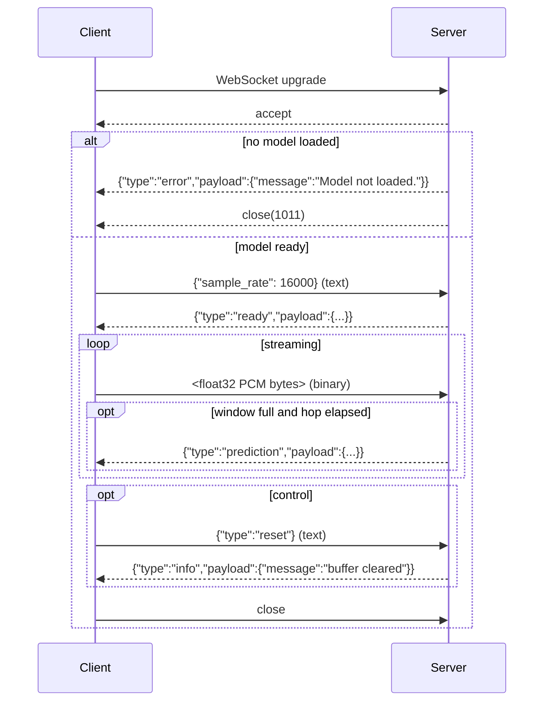

# WebSocket streaming protocol

`WS /ws/stream` — real-time emotion recognition over a bidirectional connection. Implemented in
[`main.py`](../../backend/main.py#L167) with buffering in [`stream.py`](../../backend/stream.py).

- [Overview](#overview)
- [Connection sequence](#connection-sequence)
- [Handshake](#handshake)
- [Audio frames](#audio-frames)
- [Server messages](#server-messages)
- [Control messages](#control-messages)
- [Visual streaming](#visual-streaming)
- [Timing and buffering](#timing-and-buffering)
- [Error handling](#error-handling)
- [Complete client implementation](#complete-client-implementation)
- [Testing the protocol](#testing-the-protocol)
- [Protocol limitations](#protocol-limitations)

---

## Overview

| Property | Value |
|---|---|
| Endpoint | `/ws/stream` |
| URL derivation | `API_URL.replace(/^http/, 'ws') + '/ws/stream'` — `https` → `wss` |
| Client → server | One JSON text handshake, then binary float32 frames (PCM, and optionally face landmarks); JSON text for control |
| Server → client | JSON text frames only, always `{"type": ..., "payload": {...}}` |
| Audio format | Raw 32-bit float PCM, mono, native byte order, **no header** |
| Chunk size | Any. The server buffers |
| Prediction rate | Up to 2/second (0.5 s hop) once the buffer holds a full window |
| Authentication | None |

**Every server message uses the same two-key envelope.** A client needs one parser and one switch on
`type`, and new message types can be added without breaking existing clients.

---

## Connection sequence



The no-model check happens **after** `accept()`, so the client always gets a readable error rather than a
bare handshake rejection. Slightly wasteful, considerably more debuggable.

---

## Handshake

The first frame after connecting must be **JSON text**:

```json
{"sample_rate": 16000}
```

| Field | Type | Default | Purpose |
|---|---|---|---|
| `sample_rate` | `int` | 16000 | The rate of the PCM you will send. Used to size the window and decide whether to resample |

The server responds:

```json
{
  "type": "ready",
  "payload": {
    "sample_rate": 16000,
    "model": "audio_cnn_lstm",
    "window_sec": 3.0,
    "hop_sec": 0.5
  }
}
```

| Field | Purpose |
|---|---|
| `sample_rate` | Echo of what the server understood — **check this matches what you sent** |
| `model` | Active architecture name |
| `window_sec` | Audio needed before the first prediction |
| `hop_sec` | Minimum interval between predictions |

**Do not send audio before receiving `ready`.** The `AudioStreamBuffer` is constructed from the
handshake; frames arriving earlier would be read by `receive()` before the buffer exists. In practice the
server's blocking `receive_text()` means early binary frames are consumed as the handshake and fail JSON
parsing — landing you in the silent 16000 fallback below.

The front end enforces this correctly by only starting the AudioWorklet inside the `ready` handler
([`useStream.js`](../../frontend/src/hooks/useStream.js#L57)).

### The silent fallback

```python
try:
    config = json.loads(await ws.receive_text())
    input_sr = int(config.get("sample_rate", 16000))
except Exception:
    input_sr = 16000
```

A malformed, missing, or non-JSON handshake falls back to 16000 **without any error message**. Forgiving,
and a real footgun: a client sending 44.1 kHz audio that fails to declare it will have every window
resampled as though it were 16 kHz, producing pitch- and duration-distorted audio and meaningless
predictions — with nothing in the logs. Always verify the echoed `sample_rate` in the `ready` payload
matches what you intended.

---

## Audio frames

After `ready`, send **binary** frames of raw float32 PCM:

| Property | Requirement |
|---|---|
| Sample format | 32-bit IEEE float (`Float32Array`), **not** int16 |
| Range | Nominally `[-1.0, 1.0]` |
| Channels | Mono. Mix down before sending — the server does not de-interleave |
| Byte order | Native (little-endian on x86/ARM). Not converted |
| Header | None. Raw samples only |
| Frame size | Any. 128 samples (one Web Audio render quantum) works; so does 4096 |

Server-side:

```python
pcm = np.frombuffer(chunk, dtype=np.float32)
self._buf = np.concatenate([self._buf, pcm])
```

`np.frombuffer` with `dtype=np.float32` interprets the bytes directly. Two consequences:

- **Sending int16 will not error.** It will be reinterpreted as float32, producing values in the ~1e-40
  to 1e+38 range — pure garbage, silently. There is no format negotiation and no validation.
- **A byte length not divisible by 4 raises** `ValueError: buffer size must be a multiple of element
  size`, which is caught by the outer handler and returned as an `error` frame.

In the browser, sending is trivial because Web Audio already gives you float32:

```javascript
ws.binaryType = 'arraybuffer';
worklet.port.onmessage = (e) => {
  if (ws.readyState === WebSocket.OPEN) ws.send(e.data);   // e.data is an ArrayBuffer
};
```

---

## Server messages

Four types, all sharing the `{type, payload}` envelope.

### `ready`

Sent once, after a successful handshake. See [Handshake](#handshake).

### `prediction`

Sent whenever a window completes. The payload is exactly the same shape as the
`POST /predict/audio` response body, so one client parser serves both paths:

```json
{
  "type": "prediction",
  "payload": {
    "emotion": "happy",
    "confidence": 0.8734,
    "probabilities": {
      "neutral": 0.0412, "happy": 0.8734, "sad": 0.0201,
      "angry": 0.0310, "fearful": 0.0221, "disgust": 0.0122
    },
    "latency_ms": 12.47,
    "model_name": "audio_cnn_lstm"
  }
}
```

`model_name` can change mid-stream if someone calls `POST /predict/switch` — read it per prediction
rather than caching it from `ready`.

### `info`

Acknowledgement of a control message. Non-fatal, purely informational:

```json
{"type": "info", "payload": {"message": "buffer cleared"}}
{"type": "info", "payload": {"message": "pong"}}
```

### `error`

Something failed. **The connection usually stays open** — the exceptions are the no-model case (followed
by close `1011`) and an exception escaping the main loop.

```json
{"type": "error", "payload": {"message": "Model not loaded."}}
{"type": "error", "payload": {"message": "<exception text>"}}
```

| Cause | Connection after |
|---|---|
| No model at connect time | Closed, code `1011` |
| Inference failure on one window | **Open** — keep streaming |
| Malformed binary frame | **Open** |
| Unhandled exception in the loop | Closed |

Treating a single failed window as recoverable is the right call for live audio: transient bad windows
will happen, and tearing down the connection each time would make the demo unusable.

---

## Control messages

Send as JSON **text** frames at any time after the handshake.

### `reset`

```json
{"type": "reset"}
```

Clears the accumulated buffer. The next prediction waits for a fresh full window.

```json
{"type": "info", "payload": {"message": "buffer cleared"}}
```

Useful when the speaker changes, or after a pause, to prevent a window straddling two unrelated
utterances.

### `ping`

```json
{"type": "ping"}
```

```json
{"type": "info", "payload": {"message": "pong"}}
```

An application-level keepalive, distinct from the protocol-level WebSocket ping/pong frames — useful
through proxies that idle out quiet connections. A continuously streaming client does not need it.

### Unknown control messages

Silently ignored. Invalid JSON is also silently ignored:

```python
try:
    ctrl = json.loads(msg["text"])
except json.JSONDecodeError:
    continue
```

No error is returned for either, so a client with a typo in its control message gets no feedback.

---

## Visual streaming

Opt-in, and off unless three conditions all hold: the client sets `tagged_binary`, the client sets
`visual`, and the loaded checkpoint is a fusion architecture. The `ready` payload reports what the
server actually agreed to, not what was asked for.

### Handshake

```json
{"sample_rate": 16000, "tagged_binary": true, "visual": true}
```

```json
{
  "type": "ready",
  "payload": {
    "sample_rate": 16000,
    "model": "attention",
    "window_sec": 3.0,
    "hop_sec": 0.5,
    "tagged_binary": true,
    "visual_enabled": true,
    "multimodal_model": true,
    "max_frames": 75,
    "expected_landmarks": 468
  }
}
```

| Field | Meaning |
|---|---|
| `tagged_binary` | Whether the server will read a 4-byte header on binary frames |
| `visual_enabled` | **Whether landmarks will actually be used.** Check this, not your request |
| `multimodal_model` | False for an audio-only checkpoint — vision cannot contribute at all |
| `max_frames` | Landmark window length the server buffers |
| `expected_landmarks` | Minimum landmarks per frame; extras are truncated |

`visual_enabled: false` with `multimodal_model: true` means the request was incomplete. With
`multimodal_model: false` it means the checkpoint is unimodal, and no client change will help.

### Tagged binary framing

When `tagged_binary` is true, **every** binary frame carries a 4-byte header:

```
byte 0    channel tag   0 = audio PCM, 1 = face landmarks
bytes 1-3 reserved      zero
bytes 4.. payload       float32, little-endian
```

The header is 4 bytes rather than 1 so the float32 payload stays 4-byte aligned for
`np.frombuffer`.

```javascript
function tagFrame(tag, buffer) {
  const out = new Uint8Array(4 + buffer.byteLength);
  out[0] = tag;
  out.set(new Uint8Array(buffer), 4);
  return out.buffer;
}
ws.send(tagFrame(0, pcmBuffer));        // audio
ws.send(tagFrame(1, landmarkBuffer));   // landmarks
```

**Clients that omit `tagged_binary` send untagged PCM exactly as before and are unaffected.** That
backward compatibility is tested (`test_ws_untagged_audio_still_works`).

### Landmark frames

Payload is `n_landmarks * 3` float32 values — raw `(x, y, z)` per landmark, flattened, **not
normalised**:

```
[x0, y0, z0, x1, y1, z1, ...]
```

The server reshapes to `(-1, 3)` and applies `src.features.normalize_landmarks`, the same function
that produced the training features. Normalisation is deliberately not duplicated in JavaScript — see
[frontend/video-pipeline.md](../frontend/video-pipeline.md#where-normalisation-happens-and-why).

A browser `FaceLandmarker` returns 478 landmarks (468 base mesh + 10 iris); the server keeps the
leading `expected_landmarks`. Sending more is fine, fewer is an error.

| Condition | Response |
|---|---|
| Valid frame | none — state updated silently |
| Float count not a multiple of 3 | `error` frame, connection stays open |
| Fewer than `expected_landmarks` | `error` frame, connection stays open |
| Sent when `visual_enabled` is false | silently ignored |

**Landmark frames never trigger inference.** Audio drives the clock.

### Freshness

The visual buffer tracks when it last received a frame and reports itself inactive after
`stale_after` (2 s). An inactive track yields `None` rather than a zero array, so the engine reports
`visual_active: false` and the caller knows the prediction was audio-only. Feeding zeros instead
would be indistinguishable from a real all-zero face and would silently overstate the prediction.

The visual window is sampled at the instant the audio window closes — before resampling and before
the forward pass — so server compute cannot age a live track. That ordering was a genuine bug: the
first inference pays a multi-second lazy `import librosa`, which pushed a healthy face track past
`stale_after` and silently degraded every first prediction to audio-only.

### Inspecting state

```json
{"type": "stats"}
```

```json
{
  "type": "info",
  "payload": {
    "message": "stats",
    "visual": {"frames_buffered": 30, "frames_received": 142,
               "frames_rejected": 0, "active": true, "expected_landmarks": 468}
  }
}
```

`visual` is `null` when visual streaming is not enabled. Useful for confirming frames are arriving
before debugging the model.

### What a prediction reports

```json
{
  "emotion": "happy", "confidence": 0.8734,
  "probabilities": {"...": 0.0},
  "latency_ms": 18.4, "model_name": "attention",
  "modalities": ["audio", "visual"],
  "visual_active": true
}
```

`modalities` and `visual_active` describe **that specific prediction**. A fusion model with no live
face still predicts, on a zero visual tensor, and reports `["audio"]` — because its accuracy in that
condition is not the accuracy it was evaluated at.

---

## Timing and buffering

[`AudioStreamBuffer.push`](../../backend/stream.py#L46) decides when to infer:

```python
pcm = np.frombuffer(chunk, dtype=np.float32)
self._buf = np.concatenate([self._buf, pcm])
self._since_last += len(pcm)

max_buf = self.window_samples * 2                     # bound memory
if len(self._buf) > max_buf:
    self._buf = self._buf[-max_buf:]

if len(self._buf) >= self.window_samples and self._since_last >= self.hop_samples:
    self._since_last = 0
    window = self._buf[-self.window_samples:].copy()   # most recent 3 s
    if self.input_sr != self.target_sr:
        window = librosa.resample(window, orig_sr=self.input_sr, target_sr=self.target_sr)
    return self.engine.predict(window)
return None
```

Two conditions must both hold:

1. **The buffer holds a full window** — 48,000 samples at 16 kHz for 3 seconds.
2. **A hop has elapsed** — at least 8,000 new samples (0.5 s) since the last inference.

The hop gate is what makes the protocol usable with tiny frames. A client sending 128-sample blocks at 16
kHz produces 125 frames per second; without the gate, every frame past the first window would trigger a
forward pass. With it, inference fires at most twice per second regardless of frame size.

### Timeline at 16 kHz with 128-sample frames

| Elapsed | Buffer | `_since_last` | Result |
|---|---|---|---|
| 0.0 s | 0 | 0 | `None` |
| 1.5 s | 24,000 | 24,000 | `None` — window not full |
| 3.0 s | 48,000 | 48,000 | **prediction** — both conditions met, counter reset |
| 3.2 s | 51,200 | 3,200 | `None` — hop not elapsed |
| 3.5 s | 56,000 | 8,000 | **prediction** |
| 4.0 s | 64,000 | 8,000 | **prediction** |

So: ~3 seconds of silence before the first result, then one every 0.5 s. Successive windows overlap by
2.5 s — 83% — which is why consecutive predictions are highly correlated and why single-window label
flicker is visible in the UI. Temporal smoothing across predictions is on the
[roadmap](../../README.md#roadmap).

### Memory bound

The buffer is capped at two windows (`96,000` float32 = 384 KB at 16 kHz), so a connection open for hours
uses constant memory. Older audio beyond that is discarded — deliberate, since only the most recent
window is ever used.

### Resampling

Happens **after** windowing, so exactly one `librosa.resample` call occurs per inference rather than one
per incoming frame. `librosa` is imported lazily inside the branch, so when client and model rates agree
the import never happens.

16 kHz → 22.05 kHz is an upsample by 1.378. It cannot recover content above 8 kHz that the client never
captured, so the top mel bands (`f_max = 8000`) sit at the edge of what 16 kHz can represent. A client
capturing at 22050 directly would avoid both the resample cost and the band-limit — worth doing if the
hardware allows it.

---

## Error handling

### Client disconnect

```python
except WebSocketDisconnect:
    pass
```

Normal termination. No cleanup is needed — the `AudioStreamBuffer` is local to the handler and is
garbage-collected with it.

### Inference failure

Caught inside `push` and returned as a sentinel rather than raised:

```python
try:
    return self.engine.predict(window)
except Exception as exc:
    return {"_error": str(exc)}
```

The handler checks for the sentinel key and converts it to an `error` frame:

```python
if "_error" in result:
    await ws.send_json({"type": "error", "payload": {"message": result["_error"]}})
else:
    await ws.send_json({"type": "prediction", "payload": result})
```

Using a magic `_error` key in the same dict that otherwise carries a prediction is a slightly awkward
in-band signal — a separate return type or an exception the handler catches would be cleaner — but it
keeps `push`'s signature simple and cannot be confused with a real field, since `_error` is not a
`PredictionResult` key.

### Unhandled exceptions

```python
except Exception as exc:
    try:
        await ws.send_json({"type": "error", "payload": {"message": str(exc)}})
    except Exception:
        pass
```

Best-effort notification, with the nested try guarding against the connection already being dead. The
outer handler then returns and the connection closes.

Exception text is sent verbatim to the client, which is useful in development and leaks internal detail
in production.

---

## Complete client implementation

A minimal browser client, mirroring what [`useStream.js`](../../frontend/src/hooks/useStream.js) does:

```javascript
async function startStreaming(onPrediction, onError) {
  // 1. Microphone at 16 kHz mono
  const mediaStream = await navigator.mediaDevices.getUserMedia({
    audio: { sampleRate: 16000, channelCount: 1,
             echoCancellation: true, noiseSuppression: true },
  });

  const ctx = new AudioContext({ sampleRate: 16000 });
  const ws  = new WebSocket('ws://localhost:8000/ws/stream');
  ws.binaryType = 'arraybuffer';

  // 2. Handshake as soon as the socket opens
  ws.onopen = () => ws.send(JSON.stringify({ sample_rate: 16000 }));

  ws.onmessage = async (evt) => {
    const { type, payload } = JSON.parse(evt.data);

    // 3. Only start capturing once the server is ready
    if (type === 'ready') {
      if (payload.sample_rate !== 16000) {
        console.warn('Server understood a different rate:', payload.sample_rate);
      }
      await ctx.audioWorklet.addModule('/worklets/pcm-processor.js');
      const source  = ctx.createMediaStreamSource(mediaStream);
      const worklet = new AudioWorkletNode(ctx, 'pcm-processor');
      worklet.port.onmessage = (e) => {
        if (ws.readyState === WebSocket.OPEN) ws.send(e.data);   // 4. binary PCM
      };
      source.connect(worklet);
      return;
    }

    if (type === 'prediction') return onPrediction(payload);
    if (type === 'error')      return onError(payload.message);
    // 'info' — acknowledgement, usually ignorable
  };

  ws.onerror = () => onError('Cannot reach backend.');

  return () => {                              // teardown
    worklet?.disconnect();
    ctx.close();
    mediaStream.getTracks().forEach(t => t.stop());
    if (ws.readyState < 2) ws.close();
  };
}
```

The AudioWorklet processor, which simply taps the graph and forwards each block
([`pcm-processor.js`](../../frontend/public/worklets/pcm-processor.js)):

```javascript
class PCMProcessor extends AudioWorkletProcessor {
  process(inputs) {
    const channel = inputs[0]?.[0];
    if (channel) {
      const copy = new Float32Array(channel);
      this.port.postMessage(copy.buffer, [copy.buffer]);   // transfer, zero-copy
    }
    return true;
  }
}
registerProcessor('pcm-processor', PCMProcessor);
```

The copy is required: the buffer Web Audio hands to `process()` is reused on the next render quantum, so
transferring it directly would corrupt the audio graph. The second argument to `postMessage` transfers
ownership of the copy instead of structured-cloning it — zero-copy at 125 messages per second.

A Python client, useful for testing:

```python
import asyncio, json, numpy as np, websockets

async def main():
    async with websockets.connect("ws://localhost:8000/ws/stream") as ws:
        await ws.send(json.dumps({"sample_rate": 16000}))
        print(json.loads(await ws.recv()))          # ready

        # 4 seconds of 440 Hz sine, in 0.1 s chunks
        sr, freq = 16000, 440
        t = np.linspace(0, 4.0, sr * 4, endpoint=False)
        audio = (0.3 * np.sin(2 * np.pi * freq * t)).astype(np.float32)

        for i in range(0, len(audio), sr // 10):
            await ws.send(audio[i : i + sr // 10].tobytes())
            try:
                msg = json.loads(await asyncio.wait_for(ws.recv(), timeout=0.05))
                if msg["type"] == "prediction":
                    p = msg["payload"]
                    print(f"{p['emotion']:>8}  {p['confidence']:.3f}  {p['latency_ms']:.1f} ms")
            except asyncio.TimeoutError:
                pass

asyncio.run(main())
```

---

## Testing the protocol

Five tests in [`test_api.py`](../../tests/test_api.py) cover the protocol with a mocked engine:

| Test | Covers |
|---|---|
| `test_ws_no_model_sends_error` | Error frame plus close when no model |
| `test_ws_handshake_returns_ready` | Handshake → `ready` |
| `test_ws_ready_contains_window_info` | `window_sec` and `hop_sec` present |
| `test_ws_prediction_after_window_fills` | Full path: handshake → binary frames → prediction |
| `test_ws_reset_clears_buffer` | `reset` → `info` |
| `test_ws_ping_returns_pong` | `ping` → `pong` |

`test_ws_prediction_after_window_fills` is the substantial one — it sends real float32 frames until the
buffer accumulates a window, exercising the handshake, binary framing, buffer accumulation, the hop gate,
the engine call, and the response envelope in a single path. The mock declares `sr = 22050` against a
16000 handshake, so the resampling branch runs too.

Manual smoke test with `websocat`:

```bash
websocat ws://localhost:8000/ws/stream
{"sample_rate": 16000}
# → {"type":"ready","payload":{...}}
{"type": "ping"}
# → {"type":"info","payload":{"message":"pong"}}
```

---

## Protocol limitations

**No audio format negotiation or validation.** The server assumes float32 mono at the declared rate.
Sending int16 produces garbage silently. A `format` field in the handshake, validated server-side, would
close this. (Landmark frames *are* validated — wrong sizes get an `error` frame.)

**Handshake failures are silent.** A malformed handshake falls back to 16000 with no warning. Logging the
fallback, or returning an `error`, would prevent a whole class of confusing bug.

**No backpressure.** If inference is slower than audio arrives — plausible on CPU with a fusion model —
frames queue in the socket buffer and predictions fall further behind real time with no signal to the
client. A sequence number or server timestamp in the payload would at least make the lag visible.

**Video is landmark-only.** The client streams face-landmark coordinates, not frames, so the server
never sees imagery and needs no `mediapipe` install. A pipeline wanting raw-frame features server-side
would need a different channel. See [Visual streaming](#visual-streaming).

**Window and hop are not client-configurable.** They come from `AudioStreamBuffer`'s constructor
defaults. A client wanting lower latency at higher compute cost cannot request a shorter hop.

**No authentication.** Anyone who can reach the port can stream audio and consume GPU. See
[deployment.md](deployment.md#security).

**Inference blocks the event loop.** `engine.predict` is synchronous and runs on the handler's thread, so
one client's slow forward pass delays every other connection. `run_in_executor` or a batching queue would
fix it.
