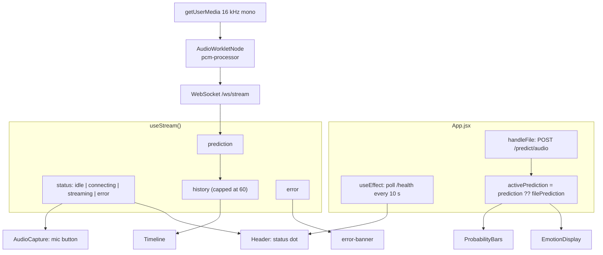

# Front end

React 18 + Vite client. Captures microphone audio and — optionally — webcam face landmarks, streams
both to the backend over one WebSocket, and renders live emotion predictions. Also supports
drag-and-drop file analysis.

- [Stack](#stack)
- [File map](#file-map)
- [Data flow](#data-flow)
- [Development](#development)
- [Configuration](#configuration)
- [Production build](#production-build)
- [Browser requirements](#browser-requirements)
- [Design decisions](#design-decisions)
- [Known limitations](#known-limitations)
- [Further reading](#further-reading)

---

## Stack

| Dependency | Version | Role |
|---|---|---|
| `react` | ^18.2.0 | UI |
| `@mediapipe/tasks-vision` | ^1.0.1 | Webcam face-landmark extraction (dynamically imported) |
| `react-dom` | ^18.2.0 | DOM rendering |
| `vite` | ^4.4.5 | Dev server and bundler |
| `@vitejs/plugin-react` | ^4.0.0 | JSX transform, HMR |

Five packages. No UI framework, no state library, no CSS framework, no router, no test runner.

That is a deliberate choice rather than an omission. The app is one screen with a handful of components
and one genuinely stateful concern (the audio stream). Redux or Zustand would add indirection around a
single custom hook; Tailwind or MUI would add a build step and a dependency to style ~340 lines of CSS.
The whole front end is 14 source files and roughly 1,330 lines including styles, which one person can
read in a sitting.

The one place this trade bites is testing — there is no JS test runner, so components and hooks have no
unit coverage. Page rendering is verified headlessly and the visual *protocol* is covered by Python
tests against the real app, but that is not the same thing. See
[Known limitations](#known-limitations).

---

## File map

```
frontend/
├── index.html                      Vite entry; mounts #root
├── package.json                    5 dependencies + setup:mediapipe script
├── vite.config.js                  dev server :3000, /api proxy
├── scripts/
│   └── setup-mediapipe.mjs          vendors WASM + face model into public/
├── public/
│   ├── mediapipe/                   gitignored; created by setup-mediapipe
│   │   ├── wasm/                    ~34 MB, copied from node_modules
│   │   └── models/                  face_landmarker.task, ~3.6 MB, downloaded
│   └── worklets/
│       └── pcm-processor.js         AudioWorkletProcessor — served as a static asset
└── src/
    ├── main.jsx                    ReactDOM.createRoot, StrictMode
    ├── App.jsx                     layout, health polling, file upload
    ├── constants.js                emotion labels, colours, emoji
    ├── index.css                   design tokens + every component style
    ├── hooks/
    │   ├── useStream.js            the streaming state machine
    │   └── useFaceTracking.js      webcam -> MediaPipe FaceLandmarker -> raw landmarks
    └── components/
        ├── Header.jsx              title + status dot
        ├── AudioCapture.jsx        mic button + drop zone
        ├── VideoCapture.jsx        webcam preview + face-tracking state
        ├── EmotionDisplay.jsx      dominant emotion
        ├── ProbabilityBars.jsx     six probability bars
        └── Timeline.jsx            scrolling emoji history
```

| File | Lines | Responsibility |
|---|---:|---|
| [`index.css`](../../frontend/src/index.css) | 415 | All styling — tokens, layout, components, animations, responsive |
| [`useStream.js`](../../frontend/src/hooks/useStream.js) | 182 | Mic → AudioContext → WebSocket → prediction state, tagged frames, teardown |
| [`useFaceTracking.js`](../../frontend/src/hooks/useFaceTracking.js) | 159 | Webcam → MediaPipe FaceLandmarker → raw landmark frames |
| [`App.jsx`](../../frontend/src/App.jsx) | 156 | Composition, `/health` polling, file upload, prediction precedence, camera lifecycle |
| [`VideoCapture.jsx`](../../frontend/src/components/VideoCapture.jsx) | 80 | Webcam preview, face-tracking status, modality disclosure |
| [`setup-mediapipe.mjs`](../../frontend/scripts/setup-mediapipe.mjs) | 74 | Vendors the WASM runtime and face model |
| [`AudioCapture.jsx`](../../frontend/src/components/AudioCapture.jsx) | 61 | Mic button state, drag-and-drop |
| [`Timeline.jsx`](../../frontend/src/components/Timeline.jsx) | 52 | History chips, auto-scroll |
| [`EmotionDisplay.jsx`](../../frontend/src/components/EmotionDisplay.jsx) | 42 | Emoji, label, confidence and latency chips |
| [`ProbabilityBars.jsx`](../../frontend/src/components/ProbabilityBars.jsx) | 33 | Six bars, always all six |
| [`Header.jsx`](../../frontend/src/components/Header.jsx) | 28 | Derived status dot and label |
| [`constants.js`](../../frontend/src/constants.js) | 19 | `EMOTIONS`, `EMOTION_COLORS`, `EMOTION_EMOJIS` |
| [`pcm-processor.js`](../../frontend/public/worklets/pcm-processor.js) | 15 | Copies each PCM block, transfers to the main thread |
| [`main.jsx`](../../frontend/src/main.jsx) | 10 | Root render |

`pcm-processor.js` lives in `public/`, not `src/`, because `audioWorklet.addModule()` fetches it by URL at
runtime — it must be served verbatim as a static asset, not bundled and transformed.

---

## Data flow



Two prediction sources converge in `App.jsx`:

```javascript
const activePrediction = prediction ?? filePrediction;
```

**Live predictions take precedence over file predictions.** Nullish coalescing, not `||`, so a
legitimately falsy value would still win — though predictions are always objects here, so it is
defensive rather than necessary. The precedence exists because a live stream is the more immediate
signal; once streaming starts, a stale file result should not linger on screen.

Note the consequence: `filePrediction` is never cleared when streaming begins, so stopping a stream
reveals the old file result again. Arguably a feature (the file analysis is still valid), arguably
surprising.

---

## Development

```bash
cd frontend
npm install
npm run dev            # http://localhost:3000
```

Vite's dev server has hot module replacement, so component edits appear without a reload. Editing
`useStream.js` while streaming will tear down the audio graph — expect to click the mic again.

The backend must be running separately on port 8000. On a fresh clone with no checkpoint, the header
shows a red dot and "No model loaded", and the mic button will connect but immediately receive an error
frame. That is the backend's [graceful degradation](../backend/README.md#startup-and-graceful-degradation)
working as designed.

### The `/api` proxy

[`vite.config.js`](../../frontend/vite.config.js) configures a proxy:

```javascript
server: {
  port: 3000,
  proxy: {
    '/api': {
      target: 'http://localhost:8000',
      changeOrigin: true,
      rewrite: (path) => path.replace(/^\/api/, ''),
    },
  },
}
```

**It is currently unused.** The app talks to the backend directly via `VITE_API_URL` and relies on the
backend's permissive CORS. The proxy is there as an alternative: point `VITE_API_URL` at `/api` and
requests become same-origin, sidestepping CORS entirely — useful if you tighten `CORS_ORIGINS` and do not
want to enumerate dev origins. The WebSocket would need `ws: true` added to the proxy config for that to
work for streaming.

---

## Configuration

One environment variable, read at **build time**:

| Variable | Default | Purpose |
|---|---|---|
| `VITE_API_URL` | `http://localhost:8000` | Backend base URL |
| `VITE_MEDIAPIPE_WASM` | `/mediapipe/wasm` | MediaPipe WASM directory — point at a CDN to skip vendoring |
| `VITE_FACE_MODEL_URL` | `/mediapipe/models/face_landmarker.task` | Face landmark model |

```bash
VITE_API_URL=http://192.168.1.50:8000 npm run dev
```

The WebSocket URL is derived by protocol substitution
([`useStream.js`](../../frontend/src/hooks/useStream.js#L4)):

```javascript
const API_URL = import.meta.env.VITE_API_URL || 'http://localhost:8000';
const WS_URL  = API_URL.replace(/^http/, 'ws') + '/ws/stream';
```

`http` → `ws` and, because the regex is anchored at the start and `https` begins with `http`,
`https` → `wss`. Correct and slightly cryptic.

**`VITE_API_URL` is inlined into the bundle at build time, not read at runtime.** A different backend
requires a rebuild. If you need runtime configuration, the usual approach is to fetch a small
`config.json` on startup, or serve the front end same-origin with the API so a relative path works.

`API_URL` is duplicated in `App.jsx` and `useStream.js` — both read `import.meta.env` independently rather
than sharing a constant. Harmless, and a candidate for `constants.js`.

---

## Production build

```bash
VITE_API_URL=https://ser.example.org npm run build     # → frontend/dist/
npm run preview                                        # serve the build locally
```

`dist/` contains hashed static assets plus `worklets/pcm-processor.js` copied verbatim from `public/`.
It is gitignored.

Serving it from nginx alongside the API — which makes CORS irrelevant — is covered in
[backend/deployment.md](../backend/deployment.md#serving-the-front-end).

**TLS is mandatory in production.** `getUserMedia` requires a secure context, so microphone capture fails
over plain HTTP on any host other than `localhost`.

---

## Browser requirements

| Feature | Used for | Fallback |
|---|---|---|
| `getUserMedia` | Microphone capture | None — required |
| Secure context | `getUserMedia` prerequisite | `localhost` counts as secure |
| `AudioContext` | Audio graph | None — required |
| `AudioWorklet` | Low-latency PCM tap | **Yes** — `ScriptProcessorNode` |
| `WebSocket` | Streaming | None — required |
| `fetch` | Health polling, upload | None — required |
| CSS custom properties | Theming | None — required |

Works in current Chrome, Firefox, Safari, and Edge. The `AudioWorklet` fallback covers older Safari and
any context where `addModule` fails.

### The AudioWorklet fallback

```javascript
try {
  await ctx.audioWorklet.addModule('/worklets/pcm-processor.js');
  // … AudioWorkletNode path
} catch {
  // AudioWorklet unavailable — fall back to ScriptProcessorNode
  const proc = ctx.createScriptProcessor(4096, 1, 1);
  proc.onaudioprocess = (e) => {
    if (ws.readyState === WebSocket.OPEN) {
      ws.send(new Float32Array(e.inputBuffer.getChannelData(0)).buffer);
    }
  };
  source.connect(proc);
  proc.connect(ctx.destination);     // required — ScriptProcessorNode needs a sink
}
```

`ScriptProcessorNode` is deprecated and runs on the main thread, so it can glitch under UI load — but a
degraded demo beats no demo. Note that it must be connected to `ctx.destination` to run at all, which the
`AudioWorklet` path does not require. That connection means the microphone is routed to the speakers,
so the fallback path can produce feedback if the user is not on headphones. Connecting through a
zero-gain `GainNode` instead would fix it.

`addModule` fails for two distinct reasons — genuinely absent API, or a fetch failure for the worklet file
(wrong base path, 404 behind a proxy). The bare `catch {}` cannot distinguish them, so a misconfigured
deployment silently degrades to the deprecated path rather than reporting a missing asset. Logging inside
the catch would be worth adding.

---

## Design decisions

**One custom hook instead of a state library.** All streaming state — status, current prediction,
history, error — lives in `useStream`. `App.jsx` consumes it and passes values down as props. With one
screen and one stateful concern, a store would be indirection without benefit.

**Server-side windowing.** The client sends whatever block size the audio graph produces and never
buffers or windows. All timing logic is in the backend's `AudioStreamBuffer`. This keeps the client
trivial and puts the window size where knowledge of the model's training duration lives.

**Raw float32 PCM over the wire, no encoding.** No MediaRecorder, no Opus, no WAV framing. The Web Audio
API already provides float32 samples and the backend consumes them directly with
`np.frombuffer(chunk, dtype=np.float32)`. Encoding would add latency and CPU on both ends for a
bandwidth saving that a LAN or broadband link does not need. The cost is 64 KB/s upstream per client.

**All six probability bars, always rendered.** `ProbabilityBars` maps over the `EMOTIONS` constant rather
than the response keys, defaulting missing values to 0. The layout never reflows as probabilities change,
so the bars animate smoothly instead of jumping.

**Health polling instead of a WebSocket status channel.** A 10-second `fetch` loop is simpler than
multiplexing status into the stream, and it works when no stream is active — which is exactly when you
most want to know whether the backend is alive.

**Emotion colours defined once.** `constants.js` holds `EMOTIONS`, `EMOTION_COLORS`, and
`EMOTION_EMOJIS`; `EmotionDisplay`, `ProbabilityBars`, and `Timeline` all read from them, so an emotion is
the same colour everywhere. Note that `EMOTIONS` must stay in the same order as `UNIFIED` in
[`src/datasets.py`](../../src/datasets.py#L9) — the bars are labelled by position-independent key lookup,
so order affects only display sequence, but keeping them aligned avoids confusion when reading a
prediction payload against the UI.

**Plain CSS with custom properties.** 338 lines, one file, design tokens at the top. No preprocessor, no
CSS-in-JS, no utility framework. See [styling.md](styling.md).

---

## Known limitations

**No tests.** No test runner is installed, so the front end has zero automated coverage — including
`useStream`, which is the most intricate code in the app. Vitest plus React Testing Library for the
components and a mocked WebSocket for the hook would be the natural addition.

**~~`status` is stale inside the WebSocket callbacks.~~ Fixed.** `ws.onclose` used to read a `status`
captured at first render (permanently `'idle'`), so its `!== 'error'` guard never fired and an errored
connection was reset to idle on close. It now uses a functional update —
`setStatus(prev => prev === 'error' ? prev : 'idle')` — which reads the current value without needing a
ref. Details in [state-management.md](state-management.md).

**No temporal smoothing.** Consecutive windows overlap by 83%, so predictions are highly correlated — but
a borderline case flips labels between adjacent windows and the UI flickers. A short moving average over
the last few predictions would stabilise the display considerably. It is on the
[roadmap](../../README.md#roadmap).

**File-upload errors are console-only.** `handleFile`'s catch logs and clears state without surfacing
anything to the user:

```javascript
} catch (e) {
  setFilePrediction(null);
  // surface as a transient alert rather than breaking the whole UI
  console.error(e);
}
```

The comment describes an intention the code does not implement. A failed upload looks like nothing
happened. Routing it into the existing `error-banner` would be a few lines.

**`filePrediction` is never cleared by streaming.** Stopping a stream reveals the previous file result.

**The `ScriptProcessorNode` fallback routes mic to speakers.** Potential feedback without headphones —
see [above](#the-audioworklet-fallback).

**History uses array index as React key.** `key={i}` in `Timeline`. Because the array is append-only and
capped by slicing from the end, indices shift when the cap is hit, which can cause unnecessary re-renders
of every chip. A timestamp-based key would be stable — `item.ts` is already stored on each entry.

**No accessibility audit.** `aria-label` and `title` are present on the mic button, but there is no
keyboard path to the drop zone's file input, no live region announcing new predictions, and no reduced-
motion handling for the pulsing and popping animations. `prefers-reduced-motion` would be a small,
worthwhile addition.

**No dark/light theming.** The palette is dark-only, hard-coded in `:root`. Tokens are in place, so
adding a light theme is a media query away — see [styling.md](styling.md#theming).

---

## Further reading

| Page | Contents |
|---|---|
| [components.md](components.md) | Props, state, and rendering logic for every component |
| [audio-pipeline.md](audio-pipeline.md) | getUserMedia → AudioWorklet → WebSocket in detail |
| [video-pipeline.md](video-pipeline.md) | Webcam → FaceLandmarker → landmark frames, and why the server normalises |
| [state-management.md](state-management.md) | `useStream` state machine, refs, cleanup, the stale-closure bug |
| [styling.md](styling.md) | Design tokens, layout, animations, theming |
| [../backend/websocket-protocol.md](../backend/websocket-protocol.md) | The wire format the client must honour |
| [../backend/api-reference.md](../backend/api-reference.md) | REST endpoints the client calls |
